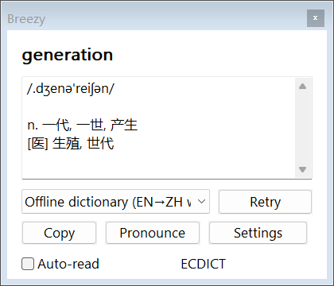

# Breezy Translate

[简体中文](README.md) | [English](README.en.md)

A native Windows translation tool. Since v2.0, Breezy uses C++ and Windows system APIs without a .NET dependency. Look up selected words, translate sentences, or translate an entire input field without manually copying and pasting text.

## Download and get started

Download the [Windows x64 portable ZIP](https://github.com/sx3111212/breezy-translate/releases/latest/download/Breezy-win-x64.zip), extract the entire folder, and run **`Breezy.exe`**. Supports Windows 10/11 x64. No .NET, Visual C++ Redistributable, or other framework installation is required. Exit the old tray app before upgrading; existing service, shortcut, and dictionary preferences are retained.

1. Select text and click the nearby bubble, or press `Ctrl+Alt+D`, to look up a word or translate a sentence.
2. Write in a supported input field and click the bubble, or press `Ctrl+Alt+E`, to translate the whole field. The default target for input translation is English.
3. Right-click the bubble or tray icon to open Settings and choose your languages and translation services.

**To use the English interface:** open Settings → General, select English as the interface language, then save. The same download supports all interface languages; a separate English executable is not required.



## Features and settings

- **Selection translation:** look up words or translate sentences near the selected text. In supported editable fields, you can also replace the selection with its translation.
- **Input translation:** translate the entire focused input field. If the original text or focused field changes during translation, replacement stops and the result remains available to copy.
- **Translation services:** use MyMemory without an API key, or configure your own Azure Translator or compatible AI service.
- **Offline dictionary:** built-in English-to-Simplified-Chinese word definitions, phonetic transcriptions, and optional expanded dictionary packs.
- **English speech:** listen through Windows' installed English voices. Optional Auto-read is off by default and its preference is saved.
- **Interface languages:** Simplified Chinese, Traditional Chinese, English, Japanese, Korean, French, German, and Spanish. Translation targets include 20 languages.
- **Separate preferences:** selection and input translation have independent targets, services, and shortcuts. The interface language is saved separately.

On first launch, the interface language and reading target follow the Windows display language, with English as the interface fallback. Saved choices are preserved on later launches.

Settings has seven sections: Selection translation, Input translation, translation services, Offline dictionary, General, Software updates, and About Breezy. The feature pages include local animated demonstrations that do not read real input or call translation services.

Shortcuts can be recorded, enabled, or disabled separately. A shortcut must include Ctrl or Alt; F12 is not supported. Enabled shortcuts must differ. Shortcut conflicts preserve the previous binding. Global shortcuts pause while Settings is open so that new combinations can be recorded.

Drag the bubble to temporarily fix its position. Restore automatic positioning through its context menu. The tray menu also provides manual input and Exit; closing a result popup keeps the app running.

## Translation services

### MyMemory

MyMemory is the default online service for sentence and input translation and needs no API key. Its availability, quality, language pairs, and usage limits depend on the provider. See the [official usage limits](https://mymemory.translated.net/doc/usagelimits.php).

Automatic source-language detection is approximate: local script checks treat Latin text as English by default. Check the source language for other Latin-script languages, mixed text, or ambiguous input. A question mark in the result popup indicates that the source language needs confirmation; click it to choose the language pair.

An optional contact email can be saved under the MyMemory service settings. It is stored locally as an ordinary preference and sent directly to MyMemory in the `de` parameter only when making MyMemory translation requests. It is not attached to AI, Azure, or offline lookups. Clear the field and save to return to anonymous requests. The app checks the email format but does not verify ownership or guarantee a quota increase.

### Bring your own AI service

Open Settings → translation services, choose the AI service type, and add a configuration. Choose a preset or custom endpoint, enter your own API key and model, then save. Multiple configurations can use different models from the same provider, and features can select their own configuration.

The app supports Chat Completions-compatible APIs and Claude's native Messages protocol. Presets include Kimi, Gemini, Claude, Doubao through Volcengine Ark, Tencent Hunyuan, DeepSeek, SiliconFlow, Qwen, OpenAI, and local Ollama. Provider accounts, model access, billing, and regional availability are managed by the user. A consumer chat subscription does not necessarily provide API access; the Tencent preset uses Hunyuan API credentials rather than a Yuanbao chat account.

Custom configurations accept a base URL or a full `/chat/completions` or `/messages` endpoint. Remote endpoints require HTTPS. Local loopback endpoints can use HTTP without an API key. Redirects are not followed automatically. Changing a preset or endpoint clears its saved key; otherwise, leaving a saved key field empty preserves the existing key.

Model lists can be fetched where supported, or a model name can be entered manually. Test translation sends a fixed “Hello” request and may incur a small provider charge. Service errors are shown without silently switching providers. Paid-provider behavior has been tested with local simulated endpoints; real paid translation results have not been verified using developer-owned API keys.

For local sentence translation, install and start Ollama yourself, download a suitable local model, then select that configuration for sentences or input translation. Breezy does not download models automatically. Ollama cloud models are not offline translation.

### Azure Translator

Configure your own API key and resource region. The app uses the global Azure Translator v3 API, including server-side source-language detection. The separate Azure China endpoint is not implemented. Requests and parsing have been tested with simulated responses; actual paid translation results have not been verified with a live Azure key.

AI and Azure API keys are encrypted with Windows DPAPI for the current Windows user and are not displayed again after saving. Requests go directly to the selected service; Breezy does not provide shared translation credits or route translations through a developer server.

## Offline dictionary

The embedded ECDICT pack contains 58,222 English words with Simplified Chinese definitions. It supports word lookup only, rather than offline sentence translation or a general multilingual dictionary.

The optional [expanded pack](https://github.com/sx3111212/breezy-translate/releases/latest/download/ecdict-full-en-zh.json.gz) contains 399,980 single-word entries. Download it and import it under Settings → Offline dictionary, or paste its direct HTTPS file URL into the dictionary download option. Retain the accompanying `ECDICT-LICENSE.txt`.

The app accepts its own `.json.gz` packs and ECDICT CSV files. Installed packs live in `%LOCALAPPDATA%\EnglishHelper\Dictionaries`. Imports and deletions take effect immediately, independently of Settings Save/Cancel. Later filenames override earlier definitions. MDict and StarDict are not supported. See [dictionary details and attribution](Dictionary/README.md).

## Privacy and compatibility

Automatic bubble positioning reads the current selection and its screen bounds locally without saving history or sending it to a service. Translation or lookup starts when you invoke it. The app does not record all keyboard input or keep translation history.

Online translation sends the requested text directly to MyMemory, Azure, or your configured AI endpoint. Offline dictionary lookup stays local. Review the selected service before translating sensitive text.

Compatibility depends on each application's Windows UI Automation support. Automatic selection positioning needs TextPattern; whole-field translation needs ValuePattern or an editable TextPattern. Password fields are excluded, and read-only fields cannot be replaced. Images, copy-protected interfaces, and some elevated windows are unsupported. Real-time grammar marking is not provided.

Fallback lookup and replacement can use the clipboard. The app attempts to restore the previous clipboard, but Windows clipboard history or third-party clipboard managers may still record these operations. Rich text may adopt the destination editor's formatting, and not every application confirms that a paste was accepted. Use the destination editor's Undo where available.

Requests are limited to 3,000 characters. Some document editors expose the entire document as one field; select a smaller passage when you only want to translate part of it. English speech requires an installed Windows English voice.

## Support development

You can support Breezy by [reporting issues](https://github.com/sx3111212/breezy-translate/issues), sharing the project, or contributing improvements. Donations are voluntary and do not affect existing features. A donation destination has not been configured yet; once available, it will be linked here and in About Breezy.

## License

This project has not been assigned an open-source license. The bundled ECDICT data is distributed under its own [MIT license](Dictionary/ECDICT-LICENSE.txt), which applies to that dictionary data only. JSON, compression, and C++ runtime notices are in [native/vendor](native/vendor) and are included in the portable package.

## Build and verify

The native implementation is in [native](native/README.md). Building requires Windows and the Zig 0.17.1 C/C++ toolchain, with no .NET SDK.

```powershell
$env:BREEZY_ZIG = 'C:\path\to\zig.exe'
powershell -ExecutionPolicy Bypass -File .\native\Build.ps1 -Check
```

The output is `artifacts\native\Breezy.exe`. The build verifies that the executable is a Windows x64 GUI application with no CLR directory and only Windows system-library imports. `-Check` also runs isolated core tests.

```powershell
Start-Process '.\artifacts\native\Breezy.exe' -ArgumentList '--native-ui-test' -Wait
Start-Process '.\artifacts\native\Breezy.exe' -ArgumentList '--native-pack-test .\DictionaryPacks\ecdict-full-en-zh.json.gz' -Wait
```

The UI tests briefly open isolated test windows and use temporary preferences, a local simulated service, and a silent speech substitute. Reports are written as `native-test.txt`, `native-ui-test.txt`, and `native-pack-test.txt` in the output directory. Checks cover service protocols, UTF-8 request segmentation, DPAPI, shortcut conflict recovery, eight UI languages, dictionary packs, safe input replacement, cancellation, model switching, and speech preferences.

To make a portable release:

```powershell
powershell -ExecutionPolicy Bypass -File .\scripts\Build-Release.ps1 -Repository sx3111212/breezy-translate -Version 2.0.0
```

The script builds the native app, runs core checks, packages the executable with its configuration, bilingual documentation and licenses, and generates SHA-256 checksums. The optional expanded dictionary is a separate attachment. See [publishing instructions in Chinese](RELEASE.md).

Project, release, and donation links are in `app-links.json`. Software updates opens GitHub Releases manually; it does not automatically download or install updates. A donation destination has not been configured yet.

Preferences remain in `%LOCALAPPDATA%\EnglishHelper` for compatibility. The original C# sources and `EnglishHelper.csproj` are retained for legacy maintenance; the native app uses neither those managed assemblies nor a bundled .NET runtime. Artwork and previews are documented in [Assets/README.md](Assets/README.md).