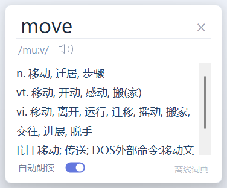

# 轻风翻译

英文品牌为 **Breezy Translate**。窗口与托盘使用完整名称；设置、关于介绍等页面内使用简称「轻风 / 輕風 / Breezy」。日语、韩语的完整名称分别为「そよ風翻訳」「산들바람 번역」，其他已支持的西文界面保留 Breezy Translate。

Windows 本地悬浮翻译工具。输入框里写好内容，点击玻璃气泡按钮，整个输入框直接翻译为设置的目标语言，默认英语。也可使用可配置的全局快捷键，无需手动复制粘贴。

## 下载与开始使用

首次 GitHub 发布正在准备中；正式发布后，安装包将提供在仓库的 Releases 页面。发布步骤与链接配置见 [发布说明](RELEASE.md)。

Windows x64 用户下载 `BreezyTranslate-版本号-win-x64.zip` 后，解压整个文件夹，双击 `EnglishHelper.exe`。发布包包含 .NET 运行时，无需单独安装；请保留同目录的配置和依赖文件。

1. 选中文字，点击附近的气泡查词或翻译；也可以按 `Ctrl+Alt+D`。
2. 在输入框写好内容，点击气泡翻译整个输入框；也可以按 `Ctrl+Alt+E`。
3. 右键托盘图标打开设置，选择目标语言和翻译服务。首次使用默认 MyMemory；AI 和 Azure 需要配置自己的服务。



## 支持开发

欢迎通过反馈问题、分享项目和参与改进支持轻风翻译。捐赠完全自愿，不影响现有功能；收款入口尚未配置，确定后会同步到此处和软件「关于轻风」页面。

## 语言、设置与快捷键

右键托盘图标或气泡，选择「设置」。设置包含「划词翻译」「输入框翻译」「翻译服务」「离线词典」「通用设置」「软件更新」「关于轻风」七页。两个功能页各自集中放置动画、目标语言、服务和快捷键；「翻译服务」统一管理 AI、Azure、MyMemory，后续服务沿用这一入口；「通用设置」只放界面语言。

- 首次以 Windows 显示语言初始化界面语言及阅读翻译目标；输入框翻译目标默认英语。三个选择分别保存，之后不会随系统语言变化覆盖用户选择。界面目前提供简体中文、繁体中文、英语、日语、韩语、法语、德语、西班牙语；未提供的界面语言回退英语。翻译目标可选 20 种语言。
- 首次使用时，划词句子翻译与输入框翻译都默认 MyMemory，无需配置 API。已有用户保存的 AI、Azure 或 MyMemory 选择保持不变。单词保留离线词典或 AI 选项，默认离线词典；该词典仅支持英语单词译成简体中文，并非通用多语言词典。
- 输入框翻译新增「原文语言」，新用户默认采用系统语言，目标默认英语；可按实际输入修改。已有配置的原文语言判断方式保持原来的自动初判。MyMemory 需要明确的原文/目标语言对，自动判断可能不准，尤其是使用拉丁字母的不同语言。选中文本的句子也可在结果卡片更正原文语言；不承诺所有语言自动识别。
- 两个功能各有对应的动画。修改目标后，示例立即变化；示例使用预置文案，不调用翻译接口。选中文字的气泡紧邻词语；输入框示例无需选中文字。动画格子只保留操作画面及暂停/重播按钮，不再重复显示标题、步骤、底部说明或快捷键。
- 默认 Ctrl+Alt+D 查询选中文字，Ctrl+Alt+E 翻译当前输入框。可在对应功能页录入、单独启用或关闭快捷键。需要 Ctrl 或 Alt，不支持 F12。两个同时启用时不能相同；注册冲突会提示并保留旧绑定。关闭一个功能的快捷键不会占用其组合键，也不影响另一个功能。
- 打开设置期间暂停全局快捷键，以便录入新的按键。保存或关闭设置后恢复。快捷键触发翻译前等待修饰键松开，避免干扰系统复制/粘贴。
- 保存之前仅更新预览；取消不改变生效设置。自动朗读、语言、快捷键、翻译服务配置共享同一份用户设置，但相互独立，旧版自动朗读设置可以保留。

## 多语言翻译服务

MyMemory 保留为免配置的原型服务，支持按指定语言对请求翻译。它没有可靠的自动语言检测；本地仅按文字脚本初判，拉丁字母文本默认英语。弹窗顶部的问号表示原文语言需要核对，点击可明确指定原文和目标语言。其他拉丁字母语言、日语纯汉字、混合文本等应手动校正。该服务质量、支持的语言对及额度均受服务端限制，不适合作为未经验证的收费承诺。

在「翻译服务 → MyMemory」可查看额度说明并选填自己的有效联系邮箱。按平台当前规则，匿名免费额度为每天 5,000 字符，提供有效联系邮箱可提高到每天 50,000 字符；实际额度以平台规则为准，不保证每个用户独享。官方说明：https://mymemory.translated.net/doc/usagelimits.php 。两个功能页选中 MyMemory 时也显示简短额度提示，可点击「管理服务」进入设置。

邮箱是可选项，按普通设置保存在本机当前 Windows 用户的配置文件内，不属于加密 API 密钥。保存后，仅在实际发起 MyMemory 翻译请求时通过 `de` 参数发送给平台，用于异常联系，不经过开发者服务器。AI、Azure、离线查词不会附带邮箱。清空邮箱并保存即可恢复匿名使用；取消不会改变原配置。软件只校验邮箱格式，不发送验证邮件，也不验证邮箱所有权或实际提额结果。

设置中的 Azure Translator 对接正式 3.0 API，提供省略 `from` 参数的服务端自动识别。需要用户自行开通并在本机填写有效 API 密钥和资源区域；密钥使用 Windows 当前用户 DPAPI 加密保存，界面不会回显已有密钥。没有有效配置不会自动切到其他付费服务。

本版支持用户自带服务账户和密钥（BYOK），费用、余额与额度由用户自己的服务商管理，翻译请求直接发送到所选服务，不经过开发者服务器。开发者不需要提供统一额度或维护翻译后台。若以后由开发者统一提供收费额度，才需要另行设计服务端代理和用量控制。

### 自带 AI 翻译服务

打开「设置 → 翻译服务」，选择服务类型「通用 AI 服务」，或在功能页点击「管理服务」，再点击「添加」。预设 Kimi（中国内地）、Gemini、Claude、豆包（火山方舟）、腾讯混元、DeepSeek、硅基流动、通义千问（中国内地）、OpenAI 和本机 Ollama，也可选择自定义接口。填写自己的 API Key，点击「获取模型列表」或直接输入模型名称，可以指定默认 AI 配置，最后「保存并应用」。同一家服务的不同模型可保存为多组配置。功能页也可直接选择某组服务/模型，不必都跟随同一个默认 AI。Azure 在同一页的服务类型中选择并填写密钥、区域；MyMemory 提供无需密钥的说明。

接口支持 Chat Completions 兼容协议和 Claude 原生 Messages 协议，不要求 OpenAI 账户。Claude 预设自动选择原生协议，Gemini 使用官方兼容入口。自定义可选择协议，填写 Base URL，也接受完整 `/chat/completions` 或 `/messages` 地址。远程接口必须 HTTPS，本机回环地址可使用 HTTP 且可不填密钥。不会自动跟随重定向；更换配置地址会清除该配置原来的密钥。密钥使用 Windows 当前用户 DPAPI 加密，保存后不回显，留空表示保留；切换预设或地址后需重新填写。

划词结果卡片始终显示服务菜单与「重译」。单个英语词可选离线词典或 AI；句子的服务选项与输入框相同，包括 AI、Azure、MyMemory。AI 模式可手动填写模型名称后点击「应用模型名称」，或获取当前服务的模型列表，再点「重译」。切换只影响当前卡片，不改默认值；已收录英语单词继续显示本地音标。服务失败会显示错误，不会偷偷换用其他服务。菜单中的「设置」可直接打开翻译服务页。

「划词翻译」页分别选择单词服务和句子服务，目标语言及快捷键也在同页。「输入框翻译」页独立选择目标语言、服务及快捷键。句子和输入框共用服务选项列表，但各自保存选择；AI 模式还可分别指定不同配置。原先的句子 AI 及其模型配置会保留，之后可以改选其他服务，后台不会强制换成 AI。

「离线词典」严格不联网，目前仅支持英译简体中文单词。划词句子使用单独选择的翻译服务，和单词是否离线互不影响。需要离线整句翻译时，请自行安装并启动 Ollama、下载适合目标语言的本地模型，然后添加「本机 AI / Ollama」配置并选作句子服务。软件不会自动下载模型；使用 Ollama 云模型不属于离线翻译。

元宝聊天应用账号/会员不能填入 API 配置；本版腾讯选项明确标为「腾讯混元（元宝非直连）」，需要腾讯混元 API Key。它不是元宝聊天接口，也不保证与元宝内的结果相同。豆包需使用火山方舟的 API Key 和已开通的模型 ID 或推理接入点 ID。

「测试翻译」会向所选接口发送固定 Hello，可能产生少量费用。获取模型列表无需生成翻译，但有些服务不提供该接口，此时手动填写模型即可。当前实现通过本机模拟接口验证多配置、默认选择、鉴权、错误处理以及查词/句子切换重译；未使用真实付费 AI 密钥验证实际译文。

预设接口参考：[DeepSeek](https://api-docs.deepseek.com/en/)、[硅基流动](https://docs.siliconflow.cn/docs/userguide/quickstart)、[通义千问](https://help.aliyun.com/zh/model-studio/compatibility-of-openai-with-dashscope)、[Chat Completions 协议](https://developers.openai.com/api/reference/resources/chat/subresources/completions/methods/create)。千问默认使用仍可用的中国内地公共域名，可自行改成控制台提供的业务空间域名或其他地域地址，密钥须匹配地域。

新增预设参考：[Kimi](https://www.kimi.com/help/kimi-api/api-troubleshooting)、[Gemini](https://ai.google.dev/gemini-api/docs/openai)、[Claude Messages](https://platform.claude.com/docs/en/api/messages/create)、[腾讯混元](https://cloud.tencent.com/document/product/1729/111007)、[火山方舟](https://www.volcengine.com/docs/82379/1494384)、[Ollama](https://docs.ollama.com/api/openai-compatibility)。各服务真实鉴权、余额及地区可用性仍需用户用自己的 API 配置测试；本机模拟接口验证不代表已实测这些付费服务。

实现验证：官方 Azure 公共语言目录可访问并包含这 20 个目标代码；自动识别请求和响应解析通过模拟服务测试。没有真实 Azure 密钥，尚未验证付费翻译的实际结果。保留服务 MyMemory 的跨语言调用另有独立冒烟测试。

参考文档：
- https://learn.microsoft.com/en-us/azure/ai-services/translator/text-translation/reference/v3/translate
- https://azure.microsoft.com/en-us/pricing/details/translator/
- https://learn.microsoft.com/en-us/windows/win32/api/winuser/nf-winuser-registerhotkey
- 商店 MSIX 签名：https://learn.microsoft.com/en-us/windows/apps/package-and-deploy/code-signing-options

## 启动

双击 `启动英语助手.cmd`。需要 Windows 和 .NET 9 Desktop Runtime；当前开发电脑已经安装。

## 使用

- 两个功能页的动画分别演示划词和输入框操作，可暂停、继续或重新播放。格子内不放多余的上下说明。示例随目标语言变化，仅作本机演示，不读取真实输入、不联网、不播放声音。切换到其他设置页后暂停动画计时。

- 写作：在支持的输入框里写好中文，不用选字，点击玻璃气泡，整个输入框的内容会直接替换为英文。翻译期间可以保留光标，原文有变化或切换输入框时会停止替换并保留译文供复制。
- 阅读：选中英文后，气泡自动出现在选区第一行的右上方，直接点气泡查询词义或翻译；结果面板在选区附近打开，可听英文读音。在可编辑区域查询整句时，也可以确认后使用译文替换选区。
- 写作：输入框获得焦点时，气泡默认附着到右上角，直接点击翻译整个输入框。右键可改为右下角。按钮位置以输入框为准，打字时不会追着光标移动。
- 未检测到选中文字或可编辑输入框时自动隐藏气泡，托盘图标继续可用。拖动气泡可以暂时固定位置；右键勾选「自动靠近选中文字和输入框」恢复自动定位。
- 气泡使用生成的透明 PNG，保留柔和边缘与阴影；悬停时显示当前操作提示，无需展开菜单再选操作。靠近气泡时暂停重新定位，避免追着鼠标移动。翻译时显示进度环，完成后短暂显示绿色勾号。
- 单词查询采用简洁白色小卡片：顶部单词，中间音标和喇叭，下方中文释义；不显示原文编辑框、翻译方向等句子操作。长释义可以滚动。点击喇叭可随时重听。
- 查词和句子卡片底部有「自动朗读」开关，默认关闭。开启时立即朗读当前已就绪的英文，以后打开新的单词释义或取得句子译文时也会自动朗读英文；关闭时停止正在播放的内容，以后仅点击喇叭才播放。开关偏好保存到 `%LOCALAPPDATA%\EnglishHelper\settings.json`，重启后继续生效。
- 句子翻译与查词采用统一的简洁白色界面，直接展示原句、译文、喇叭、复制和适用的替换操作。原句和译文均可编辑，语言方向可切换。
- 点击弹窗以外的任何地方或切换到其他窗口，会自动关闭当前弹窗，原本点击的按钮仍可正常响应。点击弹窗内部可以继续选文字、编辑、朗读或调整设置。关闭时同时停止朗读并取消未完成的翻译请求。两种面板均可拖动顶部空白处移动，也可以点击右上角或按 Esc 关闭。
- 外框由 Windows 原生合成器绘制圆角与阴影，取消二值裁剪区域，避免锯齿。系统不支持原生圆角时使用干净的矩形外框。
- 右键悬浮按钮或托盘图标可手动输入、查看说明或退出。
- 关闭结果窗口后悬浮条继续运行；退出请使用右键菜单。

## 范围与限制

悬浮按钮通过 Windows UI Automation 识别选区的文本范围与屏幕位置，以及当前获得焦点的可编辑输入框。鼠标释放后短暂等待选区稳定再定位，定期刷新也支持键盘选区。只有开放 TextPattern 选区信息的软件能自动在选区附近显示气泡；不支持时可使用托盘菜单「查询选中文字 / 发音」或「手动输入」。全框翻译仅对开放 ValuePattern 或可编辑 TextPattern 的控件生效，不同软件兼容性不同。密码框不会读取，只读区域可以查选中文字，但不会用于全框替换。本版不提供实时语法标记。

自动选区定位会在本机读取当前选中的文字与其屏幕范围，不发送到网络、不保存历史；点气泡之后才查询词典或请求翻译。输入框整体正文只在点击翻译时读取。工具不记录所有键盘输入。系统复制/粘贴用于未开放直接取词的手动查询和文字替换，尽力恢复原剪贴板；Windows 剪贴板历史或第三方剪贴板管理器仍可能记录这些操作。纯图片、禁用复制的界面和某些管理员权限窗口不支持。替换前核对控件身份和原文；全框替换再核对系统选区是否与原文一致。无法确认所有软件是否已接受粘贴，富文本可能使用目标编辑器默认格式。目标编辑器支持时，可用其撤销操作恢复。较大的文档编辑器会把整篇文档作为输入框，本版最多接受 3,000 字符；只想翻译局部时请选字后点击旁边的气泡。

英语单词译成简体中文时，MyMemory 模式下已收录词使用内置 ECDICT，显示音标和中文词义，不联网、不消耗翻译额度；选择 AI 时使用所选 AI 服务。其他目标调用用户选择的翻译服务。MyMemory 模式遇到按英语初判但未收录的单词时会提示核对拼写或原文语言，不用记忆库猜测词义。词典条目不提供自动替换按钮。详见 [词典来源与许可](Dictionary/README.md)。

在线翻译按用户选择发送至 MyMemory（`api.mymemory.translated.net`）、正式 Azure 全球接口（`api.cognitive.microsofttranslator.com`）或自行配置的 AI 服务地址。远程请求使用 HTTPS，本机 AI 可使用 HTTP 回环地址；程序不保存翻译历史。MyMemory 混合历史匹配和机器翻译，条目即使声称完全匹配也可能有错误，需要核对含义，其匿名额度为每天 5,000 字符。Azure 和 AI 的实际额度以用户账户为准。本版每次最多 3,000 字符；语言可在弹窗手动指定。Azure 中国区的独立终结点尚未接入。

英文发音使用 Windows 本机 SAPI 英语语音，优先使用系统已安装的英语语音；缺少语音时会提示安装英语语音包。词典显示已有的一份音标与词性、中文释义，不臆造英美双音标，不含完整例句。

服务文档：
- https://mymemory.translated.net/doc/spec.php
- https://mymemory.translated.net/doc/usagelimits.php

## 开发与验证

发布配置位于 `app-links.json`：`GitHubRepository` 填写 `owner/repository`，更新页会链接到对应 GitHub Releases；`ProjectUrl` 是项目主页，`DonationUrl` 是捐赠链接，均使用 HTTPS。留空时显示未配置状态。当前提供手动打开发布页，不自动检查或下载安装。本地更新日志来自 `CHANGELOG.md`。

内部程序集和配置目录保留 `EnglishHelper`，以兼容已有设置。桌面启动入口为 `启动轻风翻译.cmd`，使用 `bin\Release\net9.0-windows` 中的版本。

图片源文件、生成提示词及预览说明见 [Assets/README.md](Assets/README.md)。

```powershell
dotnet build .\EnglishHelper.csproj -c Release --ignore-failed-sources
dotnet .\bin\Release\net9.0-windows\EnglishHelper.dll --self-test
dotnet .\bin\Release\net9.0-windows\EnglishHelper.dll --ui-test
dotnet .\bin\Release\net9.0-windows\EnglishHelper.dll --dictionary-test
dotnet .\bin\Release\net9.0-windows\EnglishHelper.dll --word-view-test
dotnet .\bin\Release\net9.0-windows\EnglishHelper.dll --popup-test
dotnet .\bin\Release\net9.0-windows\EnglishHelper.dll --settings-test
dotnet .\bin\Release\net9.0-windows\EnglishHelper.dll --settings-navigation-test
dotnet .\bin\Release\net9.0-windows\EnglishHelper.dll --ai-test
dotnet .\bin\Release\net9.0-windows\EnglishHelper.dll --memory-email-test
dotnet .\bin\Release\net9.0-windows\EnglishHelper.dll --settings-preview
dotnet .\bin\Release\net9.0-windows\EnglishHelper.dll --animation-preview
dotnet .\bin\Release\net9.0-windows\EnglishHelper.dll --multilingual-smoke
```

`--self-test` 会发送两条固定测试短句到翻译服务。`--ui-test` 会短暂显示测试输入框和独立的测试程序，验证悬浮条焦点、选区取词、全框读取与替换、原文变动与焦点变动的拦截、密码框与只读控件排除，以及剪贴板恢复。结果记录在输出目录的 `self-test.txt` 和 `ui-test.txt`。

`--word-view-test` 使用隔离的临时偏好文件与语音请求替身验证自动朗读开关、偏好保存、下次查词自动播放、关闭停止与手动重听，并以静音音量验证真实 SAPI 英语语音调用。结果记录到 `word-view-test.txt`；不会改变用户的朗读偏好。

`--popup-test` 在独立测试窗口中实际点击弹窗内外，验证单词与句子的外部点击关闭、点击透传、焦点丢失关闭、无二值裁剪、关闭取消任务，以及替换原文时内部焦点切换不会误关闭。会短暂移动鼠标，结束后恢复鼠标位置、剪贴板，不修改用户设置。

`--settings-test` 使用临时配置验证系统语言初始化、旧设置迁移、独立目标保存、取消前的预览状态、真实按键录入、注册冲突回滚、禁用、DPAPI 加密及 Azure 模拟响应；不会请求真实 Azure 翻译。`--multilingual-smoke` 会向 MyMemory 发送两条固定测试短语。

`--memory-email-test` 使用模拟网络验证可选邮箱的格式校验、取消、保存恢复、清除、匿名参数省略、带加号邮箱的 URL 编码、分段请求及服务隔离；测试邮箱不会发往外部，也不会请求实际增加额度。
